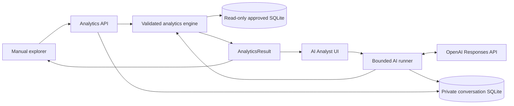

# Architecture

## One analytical engine, two interaction modes

Market Radar is a single Next.js App Router application with a Node.js runtime. React and Recharts render the workspace; TypeScript and Zod define the data and tool boundaries. Node's built-in SQLite module avoids an additional database process or third-party native database package.

The LLM chooses investigations and explains returned evidence. The backend selects approved series, computes values and changes, and determines valid views. The frontend never accepts model-generated chart coordinates.

## Pages and persistent workspace

Seven App Router pages share `src/app/(workspace)/layout.tsx`. Their common React context owns bootstrap data, active analytics, draft text and conversation streaming, so page transitions do not refetch the catalog or interrupt AI. Each page provides its own metadata; the root redirects to `/overview` and unknown paths return 404.

`src/lib/workspace-routing.ts` validates and serializes public filter state. Explorer/Analyst URLs use the same `QuerySpec` as the engine plus an allowed view. Library URLs retain discovery filters. Explicit URLs take precedence over saved session scope. Navigation revisions and cancelled superseded queries prevent stale history or analytics from overwriting a newly selected route. Conversation content and identity never enter URLs. See [Routing](ROUTING.md) for the full route contract and reload semantics.

## Data release and provenance

The immutable source archive is `0.6.0-local`, reviewed on 21 November 2026. The active source policy excludes the Thurgau vacancy dataset, leaving 3,445 observations, 595 series and 10 source datasets. National scope accounts for 2,015 observations and 168 series; 427 series are regional. Source datasets are distinct extracts, not necessarily distinct publishers.

The active counts include 3,148 reported values and 297 derived ITBoard shares. The original archive also contains 154 Thurgau aggregates that are excluded from active queries. These are not independent samples or counts of unique jobs. Missing source cells are recorded separately and are not interpreted as zeros.

The public database contains normalized series and observations, source metadata and reviews, dimension labels, denominator links, missing-cell records and selected research/policy evidence. The runtime catalog joins eligible `numeric` sources with `swiss_core` observations and applies the central source policy. The same policy governs source inventory and access to saved conversation results. Quarantined Get U Hired rows are excluded from the serving file and tools.

`src/lib/source-policy.ts` defines product availability independently of the immutable archive version. Its policy version is returned with the inventory. Removed-source results, evidence and scopes are unavailable to new queries and context recall. Historical answers referring to them are marked unavailable on read; original stored rows and unrelated conversation history are preserved.

`src/lib/data.ts` opens `data/market-radar.sqlite` with `readOnly: true` and `PRAGMA query_only = ON`. `src/lib/data-inventory.ts` derives the visible inventory from this same database. There is no second hand-maintained frontend list of observations.

The source coverage is deliberately heterogeneous:

- ITBoard supplies named skills, roles and experience within its platform sample.
- Eurostat supplies ICT online-ad statistics, including occupational shares with overlapping four-quarter windows.
- BFS supplies survey estimates by industry, not by IT occupation.
- SECO supplies registered vacancies, including national all-occupation context.
- SEM supplies a single-date administrative employment context, not programme results or IT placements.
- Fribourg remains explicitly cantonal. Excluding the Thurgau vacancy source does not remove SEM or SECO observations for the canton of Thurgau.

Source URLs, publication dates, retrieval dates and observation periods are distinct metadata. The release review date is not a claim that every indicator was observed that day. Selected HSLU notes and the saved provisional policy notice are cited evidence, not a live document search or current legal-status service.

### Preparing and reproducing the saved release

The repository excludes `data/`, raw acquisition files, `.runtime/` and secrets. A clean clone is not a self-contained data release.

`scripts/prepare-data.mjs` accepts an approved release directory as its first argument, then `MARKET_RADAR_RELEASE_DIR`, then original-workflow sibling discovery locations. It expects `manifest.json`, `market-radar-public-ch.sqlite` and the two capability JSON files. It checks release version, SHA-256 hashes, database integrity and serving scope before copying them into project `data/`; the database is renamed to `market-radar.sqlite`.

`scripts/verify-data.mjs` rechecks the prepared files against the saved manifest, integrity, source eligibility, period order and per-source counts. A local audit artifact records raw-file reconciliation, but is not required to run the app and is not distributed in Git.

These scripts reproduce serving-file installation and verification. They do not reproduce downloads, licenses review, raw parsing or the full upstream normalization process. Those require the separately retained release package and acquisition records. Updating sources therefore requires a newly reviewed release; there is no scheduled ingestion service or user-configurable source connector in this MVP.

## Analytical contracts

`src/lib/contracts.ts` is the shared contract. `QuerySpec` permits:

| Field | Meaning |
| --- | --- |
| `seriesIds` | Up to four exact catalog IDs; optional for a supported ranking |
| `mode` | `history`, `snapshot` or `ranking` |
| `measure` | `reported`, `count` or `share` |
| `geography` | Exact published geographic ID; defaults to `CH` |
| `topic`, `sourceId`, `metric` | Catalog-backed discovery or ranking constraints |
| `start`, `end` | Valid calendar dates filtering observation period ends |
| `rankingBy` | Latest value or backend-calculated absolute change |
| `limit` | Ranking size, 1–20 |

Unknown fields are rejected. There is no raw SQL, expression evaluator, generated-code executor or arbitrary filter dimension. A natural-language request can be broad, but must resolve to available catalog slices.

`AnalyticsResult` returns a stable result ID, canonical query, release, status, series with units and geographic scope, exact points and observation IDs, backend-calculated changes, source references, limitations and `allowedViews`. Allowed views are `line`, `bar`, `table` and `metric_cards`, depending on query mode. An empty result and a result truncated to the row budget are explicit states.

The engine enforces source, geography, population, measurement basis, frequency and unit compatibility. Published percentage denominators must agree. The manual comparison picker applies additional conservative metric/denominator checks. Incompatible sources can be queried separately and discussed together, but are not added or placed in a misleading shared numeric comparison.

Shares require a documented source denominator. Percentage growth is not a share. ITBoard regional stock shares have an explicit exception for their documented national total denominator; regional skill shares retain their regional denominator. Missing observations become gaps where the series calendar supports them.

Rankings align candidates on a common observation end date. Changes use common dates and are computed by the backend; changes in percentage measures are percentage points. Results contain at most 200 total points, with visible truncation instructions for long histories.

### Explorer source and topic behavior

The source selector exposes all 10 datasets, grouped by whether they support the current topic. Selecting another source chooses a supported topic and geography rather than submitting an empty intersection. The topic description explains the available coverage. A primary Choose indicator control exposes indicators for the current source, topic and geography; the separate comparison picker restricts additions to compatible definitions.

Skills and experience currently have ITBoard evidence only. Roles includes both ITBoard roles and Eurostat's seven occupational groups. BFS, SECO, SEM and cantonal context use the corresponding available indicators. Counts and reported percentages are offered according to the metric's units and documented denominator, not merely its tab label.

Only compatible candidates can be ranked together. Failed manual requests keep the previous successful controls and chart together. Returning the library from regional coverage to national coverage clears an incompatible regional-only source selection.

The Compare action is shown only when another compatible indicator exists. A single-indicator explanation distinguishes absent alternatives from different populations or definitions. The primary selector still opens those other indicators separately. At four selected series, Edit comparison keeps removal available and explains the limit. Chart selection is synchronized by both result ID and view type, including changes through the chart toolbar.

Older saved Eurostat occupational queries used `topic: context`. The engine narrowly canonicalizes that exact indicator family to `roles`; unrelated topic mismatches still fail. An explicit Eurostat Roles ranking uses its occupational shares; an unscoped Roles ranking preserves the existing ITBoard default.

## AI orchestration

`src/lib/analyst.ts` uses the OpenAI Responses API with strict tool schemas and a strict structured answer schema. The API key is read only on the server. Provider storage is disabled with `store: false`; this setting is not a claim about every aspect of provider retention.

| Tool | Responsibility |
| --- | --- |
| `get_decision_brief` | The same bounded opportunity/participant bundle as the manual decision pages; up to nine separate engine results |
| `get_data_inventory` | Full source families, coverage, dates, sample IDs, approved evidence and exclusions |
| `get_capabilities` | Search and page real catalog entries by topic, source, geography or exact IDs |
| `query_metrics` | Deterministic history, snapshot or ranking |
| `compare_metrics` | Validated comparisons and calculated changes |
| `search_evidence` | Search the small approved local evidence collection |
| `get_conversation_context` | Recall exact earlier turns and stored results from the same conversation |

The model receives a compact source inventory, active query, a ledger of prior turns, recent messages and selected verified results. It does not receive the entire database. Large results are further compacted to the first and last three points per series, with an explicit omission warning; the application retains the full bounded result for display.

Responses contain `summary`, `findings`, `limitations`, `actions`, `views` and optional `clarification`. Findings reference known result or evidence IDs. Views reference existing results and permitted view types. The UI resolves source links from stored metadata rather than model-written URLs.

Validation rejects unknown citations, unavailable views and unsupported numerical magnitudes. This does not prove the semantic correctness of every sentence; prompt constraints, visible evidence and human review remain important. One bounded repair attempt can correct a rejected final draft, with tools disabled. Invalid drafts are not displayed as verified answers.

Source documents and stored results are treated as evidence, not instructions. The analyst must distinguish unsupported intersections, unrelated questions, insufficient data and technical failures. Broader market questions should consider complementary sources rather than anchoring on an open ITBoard chart.

### Execution limits

- Six tool executions per user question, no parallel tool calls, at most eight model rounds.
- A 45-second overall analysis deadline; provider retries are disabled.
- At most 4,000 output tokens per model call, additionally bounded by the remaining 9,000-token generation allowance; a new call is refused after 8,000 generated tokens.
- A 150,000-character serialized model-input guard and a 4,000-character user-message limit.
- A 16 KiB API JSON body limit and bounded query/result sizes.

The NDJSON response streams status, validated results, evidence, the final structured answer or a typed error. It does not stream unvalidated narrative tokens. If AI is unavailable, the same manual analytics endpoints and charts remain usable.

## Conversation state

`src/lib/conversations.ts` writes to a separate SQLite database, default `.runtime/conversations.sqlite`. Public source data and private conversation data never share a file. The store keeps original turns, queries, exact results, cited evidence, scope changes and compact tool logs.

The retention design supports at least an initial question plus 20 follow-ups. A short ledger and the latest eight messages enter the prompt; older original turns and results can be fetched explicitly with `get_conversation_context`. It is not implemented as repeatedly sending all prior messages or relying solely on a lossy summary.

The current limits are 100 questions per conversation and 100 active conversations. Capacity errors preserve existing history. Sessions have a sliding 48-hour backend lifetime; the HTTP-only browser cookie has a 24-hour lifetime and is renewed by session responses. Clearing or losing the cookie loses access to that anonymous conversation; there is no account-based recovery.

SQLite uses WAL mode, bounded journal settings and a 32,768-page database cap. A per-session lock prevents concurrent analyses from overwriting context. Release IDs protect against mixing results from different releases.

## HTTP surface and local operations

| Endpoint | Purpose |
| --- | --- |
| `GET /healthz` | Data health and whether an AI key is configured; not a live provider connectivity test |
| `GET /api/bootstrap` | Catalog, inventory, initial result and multi-source overview |
| `POST /api/decision-brief` | Read-only bounded decision bundle; validated filters, same-origin and analytics request limit |
| `POST /api/analytics` | Validate and execute a manual query; save the resulting scope |
| `POST /api/analyst` | Bounded AI workflow as NDJSON |
| `GET /api/conversation` | Current session history and referenced results |
| `POST /api/conversation` | Start a new conversation |
| `PATCH /api/conversation` | Persist an explicit decision/chart context handoff in the current session |

Mutation endpoints check origin and fetch-site headers. Anonymous session cookies use HTTP-only and SameSite=Lax, with Secure enabled on HTTPS. In-memory request limits are 90 analytics, 12 analyst and 30 session requests per minute per derived client IP. These are single-process MVP protections, not authentication or distributed abuse prevention. A public reverse proxy must supply trustworthy forwarding headers.

`npm run build` produces a standalone Next.js build. `npm start` loads local environment variables, installs static assets into that output and launches on loopback, port 3000 by default. `/healthz` can support external process supervision. Runtime secrets, conversations and test output are excluded from file tracing.

The checked local workflow is Windows with Node.js 24.9+. Production at `https://hackatonprojekt.net` runs a native Linux ARM64 standalone build in a single non-root Docker container behind the host's Caddy HTTPS proxy. The approved dataset is a read-only bind mount; the writable conversation directory is a separate persistent mount. The container has a read-only root filesystem, bounded temporary storage, a 2 GiB memory limit, two CPUs, rotated logs and an `unless-stopped` restart policy. Its health check reads the real catalog. `deployment/backup-runtime.py` creates and verifies private online SQLite backups; backup scheduling and off-host copies are not configured. See [Deployment](DEPLOYMENT.md) for the reproducible process and rollback boundaries.

## Validation and known boundaries

`npm test` covers verified values and denominators, catalog access, compatibility failures, source/topic transitions, saved-query migration, invalid inputs, conversation isolation and 20-follow-up recall. AI unit tests use a mock provider. `npm run test:api` checks a running local app. `npm run data:verify` checks the installed frozen release. Browser QA helpers require an installed browser and a running app; configure `MARKET_RADAR_TEST_URL` and, if needed, `PLAYWRIGHT_CHROMIUM_EXECUTABLE_PATH` or `PLAYWRIGHT_CHANNEL`. They are not a complete deployment CI suite.

The prototype does not implement live collection, email reports, authentication, unrestricted source addition, role-by-skill intersections, forecasting, candidate matching or programme-outcome measurement. Provenance and numerical validation improve reliability, but do not turn a platform sample or administrative statistic into a complete, representative measure of Swiss IT hiring.

## Decision brief contract

`decisionScopeSchema` accepts a workspace kind plus documented role, group and geography filters; backend validation rejects irrelevant dimensions and checks catalog availability. `getDecisionBrief` calls the existing deterministic engine for every panel. Participant groups and metrics remain separate results with their own IDs and sources. The HTTP endpoint and AI tool call this same service; no synthetic cross-source result or new numerical dataset is introduced. Bootstrap remains unchanged so these panels load only when requested.

`POST /api/analyst` additionally accepts `brief`: a validated decision scope, null to clear it, or omission to retain stored scope. The server saves it in the additive `conversation_briefs` table, keyed by the existing anonymous session. The AI state receives it as starting context; the latest user question still takes precedence. A successful brief tool emits a typed `brief` event, saves each result, and lets the existing answer validator check citations and numbers. `GET /api/conversation` returns the saved brief alongside the existing history. Original messages, 20-follow-up recall, session isolation and six-tool-call budget remain intact; seven tool definitions are available. The added table is created with IF NOT EXISTS and does not alter existing rows; the previous application can still read the conversation store on rollback.

Explicit UI context changes do not depend on sending a model request. `PATCH /api/conversation` accepts `{ brief: DecisionScope | null, context?: QueryInput }`, validates both against the catalog/engine before mutation, and uses the existing session lock. Successful handoffs return the saved brief and optional deterministic result; the UI navigates after saving. Clear-only changes retain the working chart. Errors remain visible and do not claim a successful context change. An active AI turn holds the same lock; the UI asks users to finish or stop it before changing its context.

Manual Explorer calculations send `X-Radar-Context: chart` to clear the old decision brief when a nonempty result is applied. AI URL restoration and reviewing cited evidence preserve the brief. Explicit manual evidence handoffs clear it, including when opening the same already-visible chart. This avoids resurrecting a previous group, canton or role after reload. Context writes retain same-origin validation, bounded JSON, per-IP rate limits and session isolation. No database migration is needed.
